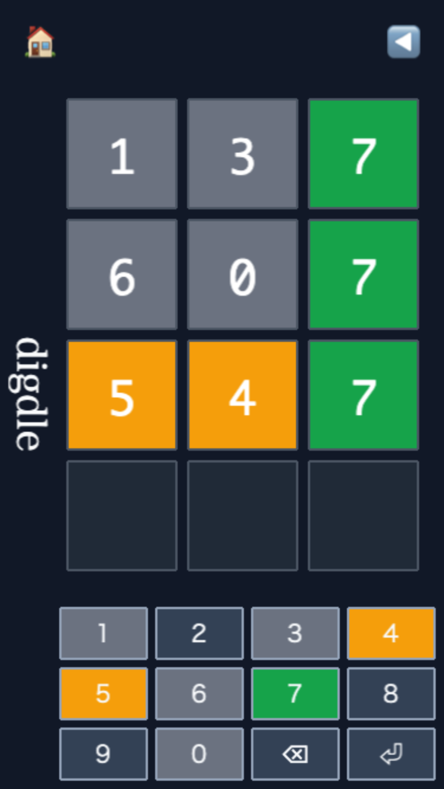

# digdle

素数を当てろ! wordle風・素数当てゲーム登場!!

## どんなゲーム?

- お題は 2〜6 桁の素数
- 予想した素数を入れると、色ヒントが返ってくる
- ヒントを頼りに正解をしぼっていく
- 制限回数内に当てたらクリア!

### 色ヒント

- 緑: 数字も場所も正解
- 黄: 数字はあるけど場所違い
- 灰: その数字は使われていない（重複ルールあり）

## 操作方法

- Title: モード（ノーマル / ハード / デイリー）を選び、桁数のボタンか数字キー 2〜6 でゲーム開始。桁数ボタンの下（画面が低いときは右）では、ボットが 4 桁の素数を推理する様子のデモが流れる（操作は受け付けない。画面が小さいときは出ない）
- 数字キー: 入力
- Backspace: 1 文字削除
- Enter: 判定
- 画面上のキーボードでも遊べる
- 右上の ◀️（プレイ中）や、結果表示の「桁数を選び直す」で Title に戻る。左上の 🏠 はゲーム一覧へ
- 結果表示には、いま遊んだモード・桁数の戦績（勝率・連勝・平均の試行回数）が出る。戦績はこの端末のブラウザに保存される（途中で離れたラウンドは数えない）。「戦績を消す」を 3 秒以内に 2 回押すと、すべて消える

## モード

- ノーマル: まずはこっちでOK
- ハード: 出たヒントを次の手でもちゃんと守るモード
- デイリー: 日付と桁数で決まる「今日の 1 問」を、1 日 1 回だけ遊ぶモード（同じ日・同じ桁数なら誰でも同じお題。日付は端末の 0 時で切り替わる）
  - ルールはノーマルと同じ。途中で抜けても、入力した推測は残って続きから再開できる
  - 終えた桁数には、デイリーを選んだ Title で ✓（クリア）/ ✗（失敗）が付く。押すと、その日の盤面と結果を見るだけ（やり直しはできない）
  - 記録はこの端末のブラウザに保存される（保存できない環境でも遊べるが、ページを開き直すと忘れる）

## ルール

- 入力値は N 桁の素数のみ有効
- 桁違い/非素数は無効入力（回数は減らない）
- 試行回数は桁数に応じて変化
  - 2 桁: 3 回
  - 3 桁: 4 回
  - 4 桁: 5 回
  - 5 桁: 6 回
  - 6 桁: 7 回

## コツ

- 最初は数字がバラけた素数で情報を集める
- 黄は「場所入れ替えヒント」として使う
- ハードは整合性チェックが命

## 開発メモ

- 依存インストール: npm install
- 開発サーバー: npm run dev
- ビルド: npm run build
- テスト: npm run test

詳細仕様は docs/spec.md を参照してください。
