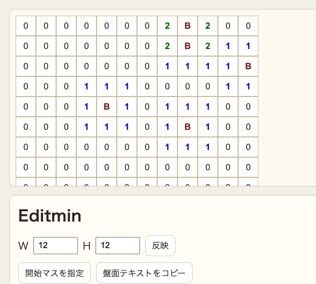

# editmin

作ってニヤけろ! マインスイーパー問題メーカー、爆誕!!

## どんなツール?

- マスをポチポチして地雷配置を作る
- 数字は自動で再計算
- 難易度と「論理で解けるか」をその場でチェック
- 作問と調整をテンポよく回せる

## 操作

- セルを左クリック: 爆弾の配置/解除
- 幅・高さ入力: 盤面サイズ変更
- 開始マス指定: 指定モードでセルを選択
- 盤面テキストをコピー: 盤面を `X`（開始マス）・`B`（爆弾）・数字のテキストでコピー
- 盤面が大きいとき: 盤面エリアをスクロールして移動
- 表示のズーム: サイドバーの「−」「＋」「フィット」、キー `+` / `-` / `0`（フィット）、Ctrl（⌘）+ホイール。小さくするとマスが 20 px 未満で数字を省き、地雷を濃い面で塗る
- 地雷の見せ方: サイドバーの「表示: ○○」ボタン、またはキー `M` で、絵 → 数字 → 両方 → 絵 と切り替える。絵は地雷を濃い面で塗り、他のマスを淡く（数字は出さない）。数字は今までどおり。両方は地雷を濃い面で塗り、数字も出す（地雷に「B」は出さない）。初期は数字
- プレイ: 開始マスを指定してから「プレイ」を押すと、盤面を遊べる。最初に開くのは開始マス（周りへ連鎖して開く）。数字を見て、地雷のないマスを左クリックで開いていく。地雷を開くと爆死、地雷以外をすべて開くとクリア。「編集に戻る」で編集に戻る（盤面は変わらない）。旗はない。開始マスが未指定のときは押せない。爆弾が 0 個の盤面は、開始マスを開いた時点でクリア。数字はマスが 20 px 以上のときに出る

## ルール

- 開始マスとその周囲 8 マスには爆弾を置けない
- 数字は隣接爆弾数に応じて常時更新
- 制約違反の設定は拒否される

## 判定

- 難易度は Easy / Normal / Hard / Expert
- スコア根拠も表示されるので調整しやすい
- 仮定なしで解ける盤面かどうかも確認できる

## こんな人向け

- マインスイーパー問題を作成したい人
- 作問の難易度を定量的に見たい人
- 推理で解ける問題だけを公開したい人

## 開発メモ

- 依存インストール: npm install
- 開発サーバー: npm run dev
- ビルド: npm run build
- テスト: npm run test

詳細仕様は docs/spec.md を参照してください。
