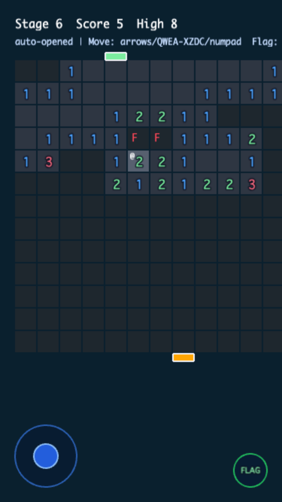

# Minefield Rogue

踏むな、読み切れ! 推理で抜ける地雷原ローグライク!!

## どんなゲーム?

- 数字ヒントを読んで地雷位置を推理
- 8方向移動で、上り階段（▲）から下り階段（▼）を目指す。1 つのフロアは 3 つの部屋（スタートの部屋 A に扉が 2 つ、つながる部屋 B・C）で、壁の扉（+）の向きへ進むと通路を自動で歩いて、つながる部屋に渡ります。下り階段はどちらか 1 つの部屋にだけあり、もう一方は行き止まりです（部屋は行き来できます）
- 合ってるフラグなら地雷マスも通過できる
- ミスったら即ゲームオーバー。緊張感高め

## 特徴

- 全ステージが推理だけで解けるように生成
- 運任せの当て推量を前提にしない設計
- 進むほど盤面サイズと難易度が上昇
- 死亡するとゲームオーバー。まず全爆弾が表示され（死んだマスに「†」）、タップ・クリック・R と T 以外のキーで墓石画面（死んだステージ・死因・スコアとハイスコア・新記録）に進みます。RETRY（R。全爆弾の表示の時点からでも押せます）は同じステージ番号の新しい盤面で、NEW GAME はステージ 1 から（開発用のサーバーでは保存した開始ステージから）、TITLE（T）はタイトル画面へ戻ります

## 操作方法

- 開始: 起動すると Title 画面が出ます（ボットが推理してステージ 1〜3 を進めるデモが流れます）。「Start」をタップ / クリックするか、Enter / Space で始まります
- スマホ: 隣のマスをタップで移動、左下の仮想パッドで移動（タップでコード操作）、右下の FLAG ボタンでフラグモード、（開発用: `npm run dev` のときだけ、右上の STAGE ボタンで開始ステージ（1〜100）を選択。公開版には出ません。URL の `?stage=` は公開版でも使えますが、ページを開いて最初のゲームにだけ効きます）
- 移動: 矢印キー / テンキー 1-9（5除く）/ QWEA + XZDC
- フラグ: Shift + 方向キー（隣接マスへ設置・解除）
- コード操作: S またはテンキー 5
  - 条件がそろうと自動展開や自動フラグ補助が動く

## ルール

- 爆弾をフラグなしで踏むと即死
- 非爆弾にフラグを立てて踏んでも即死
- 数字と矛盾しないルート作りがカギ

## こんな人向け

- マインスイーパーの論理推理が好きな人
- 緊張感のある1ミス即終了ゲームが好きな人
- 反射より判断を楽しみたい人

## 開発メモ

- 依存インストール: npm install
- 開発サーバー: npm run dev
- ビルド: npm run build
- テスト: npm run test

詳細仕様は docs/spec.md を参照してください。
