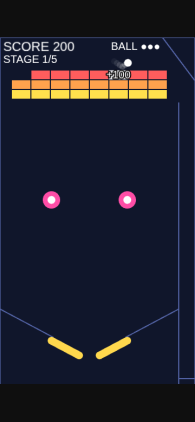

# flipbreak（フリップブレイク）

フリッパーで玉を打ち上げて、ブロックを全部崩せ！ ブロック崩し × ピンボール。



## どんなゲーム?

- 縦長のピンボール台の上に、ブロックが並んでいる。台の下には左右のフリッパー、途中にはバンパー
- 右端のレーンで玉を溜めて発射する。溜めが強いほど高く上がる（弱いと台に出られず、レーンに戻る）
- 落ちてくる玉をフリッパーで打ち上げて、ブロックに当てる。バンパーは玉を勢いよく弾く
- ブロックを全部崩すと面クリア。面は 5 つ（面ごとにブロックの並びとバンパーの位置が違う）
- 玉を台の下に落とすと残りの玉が 1 減る。玉 3 個がなくなるとゲームオーバー。5 面を全部崩すと全面クリア
- 玉がどこかで止まって動かなくなったら、5 秒後にレーンへ戻る（玉は減らない）

## スコア

- ブロック 1 個につき 100 点、バンパーに当たるたびに 10 点
- 玉を落とすと、画面が揺れて赤く光り、残りの玉の ● が点滅する。ブロックを崩すと「+100」が出て、画面上部の SCORE が一瞬大きくなる
- 自己ベスト（スコアと到達した面）はブラウザに保存される

## 操作方法

### スマートフォン / タブレット

- 玉の発射: 玉がレーンにある間、画面のどこかを押し続けて溜め、離して発射。溜めの棒（緑 → 黄 → 橙）の白い線を超えると台に出る
- フリッパー: 画面の左半分を押している間は左、右半分を押している間は右が上がる
- ボタン: START / もう一度 / タイトルへ をタップ
- 横向きで画面が小さいときは「画面を縦にしてください」と出る。縦にすると続きから遊べる

### PC

- フリッパー: ← または Z（左）、→ または `/`（右）
- 玉の発射: ↓ または Space を押し続けて溜め、離して発射
- 開始・もう一度: Enter / Space
- タイトルへ（結果画面）: Esc

## 開発

```bash
npm run dev            # 開発サーバー
npm run lint
npm run test
npm run test:coverage
npm run build          # dist/ に静的サイトを出力
```

仕様は [docs/spec.md](docs/spec.md)。今後の拡張の候補は [docs/backlog.md](docs/backlog.md)。
