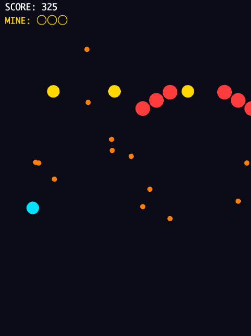

# shoot1

避けて、置いて、まとめて吹っ飛ばせ! 地雷つき弾幕サバイバル!!

## どんなゲーム?

- 弾幕をひたすら避けて生き残る
- 地雷を置いて敵と弾をまとめて爆破
- 開始直後から敵が出て、時間がたつほど密度アップ
- 最初の 30 秒は 10 秒ごとに新しい要素が加わる（0〜10 秒: 直下弾だけ → 10 秒: V 字編隊と自機狙い弾 → 20 秒: 3-way 弾）
- 30 秒を過ぎると、単体の敵が 12 秒ごとに 1 体ずつ出る。突進する敵（菱形）は自機に向かって真っすぐ来て、触れるとゲームオーバー。停止して撃つ敵（赤い円）は画面上部で 3 秒止まって弾を撃ってから去る
- 被弾か自爆でゲームオーバー（突進する敵に触れた場合も）

## 操作方法

### PC

- 移動: 矢印キー または WASD
- 地雷設置: Space または Z
- リスタート: ゲームオーバー時に R

### スマートフォン/タブレット

- 左下の仮想スティック: 移動
- 右下の BOMB ボタン: 地雷設置
- ゲームオーバー画面タップ: リスタート

## 地雷のポイント

- 初期所持は 3 発
- 設置後 0.5 秒は自機との接触判定を無効化
- 約 10 秒経過でも自動爆発
- 爆風範囲内の敵機と敵弾を同時に消せる
- 置きっぱなしは自分が巻き込まれやすいので注意
- 自機が爆風範囲に入っている間は、その地雷のまわりに赤い輪が出る（範囲外に出ると消える）
- 爆発の 3 秒前から、地雷のまわりの輪が縮んで、地雷の大きさになったところで爆発する

## アイテム

- 地雷で倒した敵機が、約 3 割の確率でアイテムを落とします。ゆっくり落ちてくるので、自機で触れて取ります（敵弾や爆風には影響されません。画面の下に出ると消えます）
- 黄色の丸に「+」: 地雷が 1 発増えます（最大 5 発。爆発で戻るのは今までどおり 3 発まで）
- 水色の輪: バリアです。自機のまわりに水色の輪が付き、画面の左上に「BARRIER」と出ます。ゲームオーバーになる原因（被弾・突進する敵・自分の地雷に触れる・爆風）を 1 回だけ防ぎます。使うまで持ち越せます
- バリアが壊れてから 1 秒間は、自機が点滅して、何が当たってもゲームオーバーになりません（自分の地雷に触れても爆発しません）。バリアで防いだ地雷の爆発は、そのまま敵と弾を巻き込みます

## 敵弾の見分け方

- 直下弾: 橙の丸 / 自機狙い弾: マゼンタのひし形 / 3-way・5-way 弾: 黄緑の三角 / 全方位弾: 淡い紫の丸 / 高速弾: 尾を引く白い弾
- 背景: 暗い紺の下地に走査線と流れる星。経過時間の段階で下地の色味が少しずつ変わる。自機は水色の三角、敵機は赤い菱形（当たり判定は従来どおりの円で、見た目の角の外側の円の部分に当たっても当たらない）

## スコア

- 生存時間をスコア化
- できるだけ長く生き残ることが目標

## こんな人向け

- 短時間で遊べるシューティングを探している人
- 回避と設置の判断を楽しみたい人
- タッチ操作で弾幕ゲームを遊びたい人

## 開発メモ

- 依存インストール: npm install
- 開発サーバー: npm run dev
- ビルド: npm run build
- テスト: npm run test

詳細仕様は docs/spec.md を参照してください。
